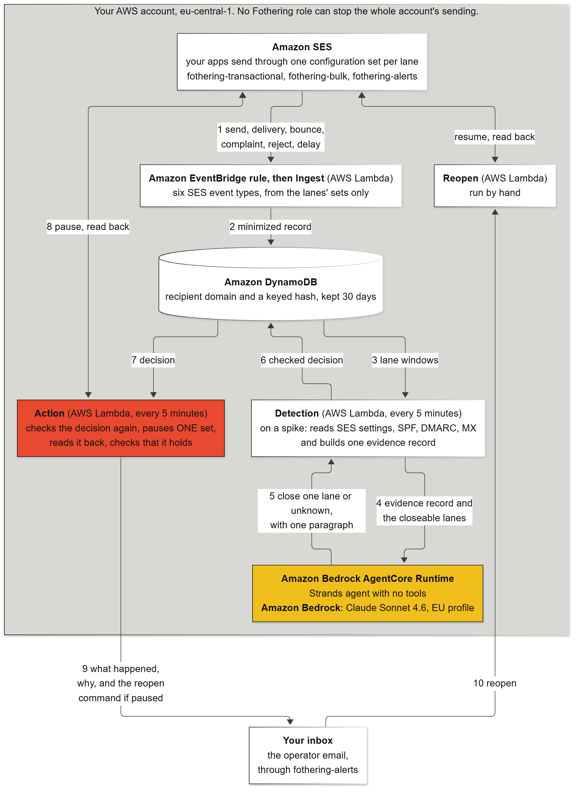

# Architecture



Everything runs in your own AWS account in `eu-central-1`, from the four CDK stacks in
`packages/infra/src`: `FotheringIngest` (`ingest-stack.ts`), `FotheringRuntime`
(`runtime-stack.ts`), `FotheringDetection` (`detection-stack.ts`) and `FotheringAction`
(`action-stack.ts`). The numbers below follow the arrows in the picture.

1. Your apps send through Amazon SES, one configuration set per lane, each listed in `lanes.json`.
   Each set publishes six event types to the EventBridge default bus: send, delivery, bounce,
   complaint, reject and delivery delay. The stacks create no configuration set.
2. A rule in `ingest-stack.ts` forwards those events, from the lanes' sets only, to the ingest
   function. It stores one minimized record per recipient in DynamoDB: the receiving domain and an
   HMAC of the address under a key held in Secrets Manager, with no subject and no headers. Each
   record expires 30 days after its send.
3. Every five minutes the detection function reads each lane's recent windows.
4. A spike opens an incident. Only then does detection read the SES settings (identities,
   configuration sets, event destinations) and DNS (SPF, DMARC, MX), and build one evidence record.
   Code, never the model, decides which lanes may be closed: a transactional lane never is. Detection
   invokes the agent with that record, at most three times per incident and six times a UTC day.
5. The agent runs on Amazon Bedrock AgentCore Runtime, built with the Strands Agents SDK, and holds no
   tools. It asks Claude Sonnet 4.6 on Amazon Bedrock through the EU inference profile
   (`eu.anthropic.claude-sonnet-4-6`) and answers with a structured decision: close one of the
   lanes the record offers, or unknown, with one explanation paragraph.
6. Detection checks that answer again before it stores the decision: the option must be one it
   offered, and the paragraph must pass the text checks against the record.
7. Every five minutes the action function reads the stored decisions and reads the SES settings
   again. A record older than an hour is never acted on.
8. When the decision and the fresh checks still agree, it pauses that one configuration set
   (`PutConfigurationSetSendingOptions`) and reads the setting back (`GetConfigurationSet`). It then
   waits out a one-minute hold, in which SES may still send what it had already accepted, and five
   minutes after that checks that nothing more was sent through the set. Its role may pause only the
   sets `lanes.json` lets the action close.
9. It emails the operator through the `fothering-alerts` set: the cause with its evidence, what was
   paused and when the read-back confirmed it, what stays open, and the command that reopens the lane.
10. The operator runs the reopen function by hand ([reopen-a-lane.md](reopen-a-lane.md)). It turns
    sending back on for a set Fothering paused and reads the setting back.

Every role in every stack carries an explicit Deny on three SES actions that IAM cannot limit to
one resource: `PutAccountSendingAttributes` and `UpdateAccountSendingEnabled`, which stop the whole
account's sending, and the v1 `UpdateConfigurationSetSendingEnabled`, which could switch any set.
A Deny wins over every Allow, so no later grant can stop the whole account. The action stack holds
the only SES writes, so a deployment without it watches and detects but never pauses anything. The
ingest, detection and action functions have CloudWatch alarms on their errors and on their
error-level log lines. The alarms notify no one yet: you read their state in CloudWatch.

The picture is drawn from [architecture.mmd](architecture.mmd). After a change, render it again with
mermaid-cli:

```sh
mmdc -i docs/architecture.mmd -o docs/architecture.png -b "#FFFFFF" -s 2
```
